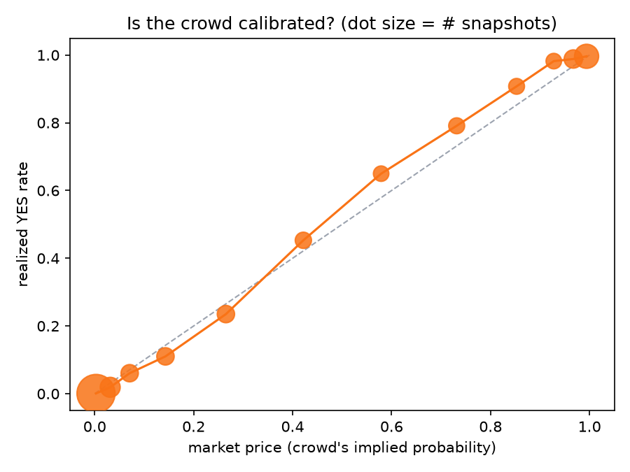
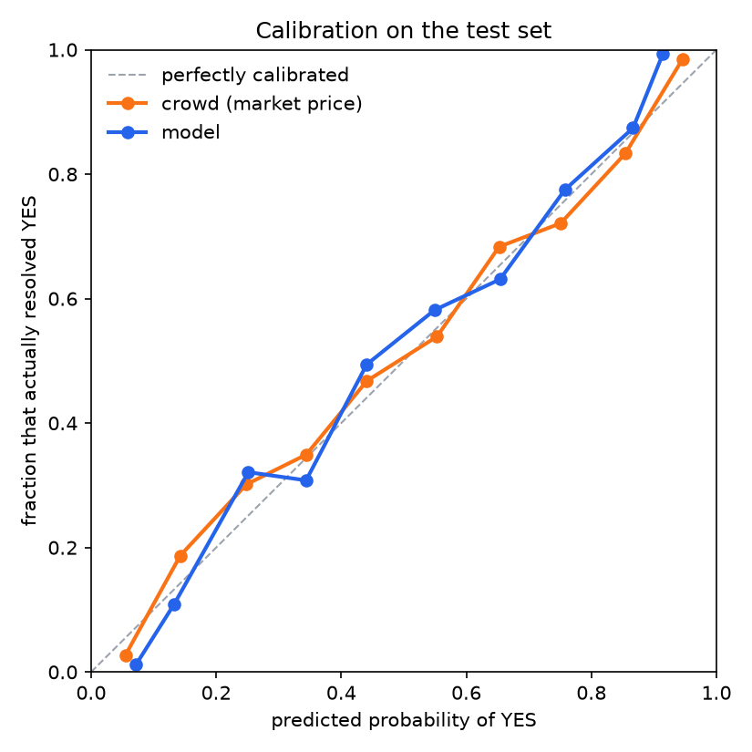
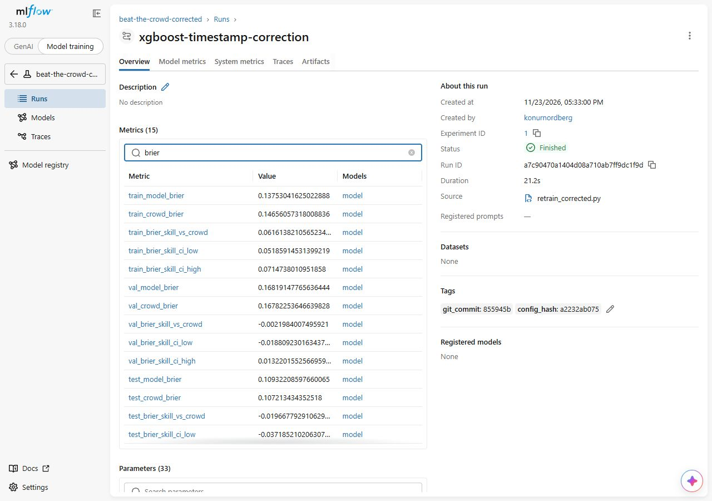
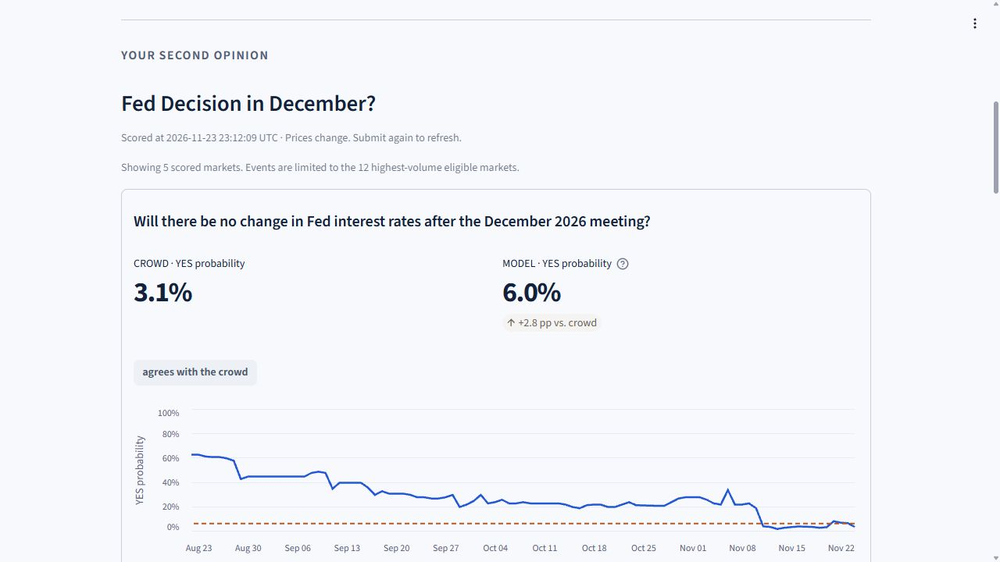

# Beat the Crowd

**Can a model trained on thousands of resolved Polymarket markets tell when today's crowd is wrong?**

Prediction markets had a huge 2026. Around the midterms, Polymarket odds were quoted on cable news next to the polls, and people are now betting real money on everything from Fed decisions to ceasefires. The pitch for these markets is that the price *is* the best available probability: if a contract trades at 30¢, the crowd thinks there's a 30% chance it happens.

We wanted to test that pitch. We pulled every resolved Yes/No market we could find, froze each one at several points before it closed, and trained a model to predict the outcome using prices available at that moment, *including the crowd's own price*, plus the downloaded market metadata. The limitations below distinguish these retrospective snapshots from a fully archived real-time experiment. If the crowd is efficient, the model should learn to just copy the price. If the crowd has systematic blind spots, the model should find them.

Paste any live Polymarket link into the app and it shows you the crowd's probability next to the model's.

| | |
|---|---|
| **Live app** | [Cloud Run app](https://beat-the-crowd-app-64wo2oghua-ue.a.run.app) — public; corrected release verified |
| **API** | [API docs](https://beat-the-crowd-api-64wo2oghua-ue.a.run.app/docs) — corrected model live |
| **Data** | `gs://beat-the-crowd/v1/` (public, see [Data](#data)) |

---

## Corrected results and a temporal-leakage fix

**The corrected model does not beat the crowd on held-out Brier score.** XGBoost was the better of our two learned candidates on validation, but the raw crowd probability was better than both. This is a result worth reporting: the project demonstrates a reproducible pipeline and a working probability-comparison app, not a profitable betting strategy.

During the submission audit, we found a timestamp-unit bug in training. The Parquet data stored timestamps in microseconds, but feature construction divided their integer values by a nanosecond conversion factor. The resulting times fell near 1970, so future prices could enter earlier snapshots. The previous model and its reported metrics are invalid. Reproducing those numbers only reproduced the bug; the earlier tests did not cover this Parquet representation.

Commit `855945b` makes the conversion explicit and adds regression coverage for the affected path. We retrained **both** XGBoost and logistic regression on the same corrected split, then selected the learned model by **validation Brier score**, without using test scores for that selection. The [corrected training record](docs/training-verification.json) contains both runs, full-precision metrics, source revision, data hashes, and model hashes. The corrected release is now deployed. [Fresh public HTTP checks](docs/deployment-verification.json) at 23:11:11 UTC on November 23, 2026 verified its model card, raw prediction, five live-market predictions, and frontend health. The [independent release audit](docs/release-verification.json) confirms artifact/data checksums and matching published/served model cards. [Hosted browser inspection](docs/browser-verification.json) also passed. Earlier evidence from the invalid model remains superseded.

| | Validation | Test (Oct 4–Nov 14, 2026) |
|---|---|---|
| **Crowd** Brier | **0.1678** | **0.1072** |
| **XGBoost** Brier | 0.1682 | 0.1093 |
| XGBoost Brier skill vs. crowd (95% CI) | −0.22% (−1.88% to +1.32%) | **−1.97% (−3.72% to −0.51%)** |
| XGBoost paper-trading ROI | +27.10% | −37.97% |
| **Logistic regression** Brier | 0.1716 | 0.1159 |
| Logistic regression Brier skill vs. crowd (95% CI) | −2.26% (−4.57% to −0.28%) | −8.13% (−10.50% to −6.17%) |
| Logistic regression paper-trading ROI | +6.15% | −35.77% |

Lower Brier is better; negative skill means the model has more error than the crowd. XGBoost's test interval is entirely below zero, indicating worse performance in this retrospective test sample. The event bootstrap accounts for related markets within an event, but it does not remove the sampling and metadata limitations described below. Paper-trading ROI ignores fees and slippage and is not a deployable trading strategy.

The corrected features produce **44,346 snapshots**, of which **23,135 (52.2%)** have crowd probabilities between 3% and 97%. These contested snapshots cover **7,385 markets** and split into **16,292 training**, **3,229 validation**, and **3,614 test** rows. Filtering changes the events available for splitting, so the old sample counts and period boundaries also no longer apply.

These figures are generated from the corrected XGBoost run. Calibration across all snapshots is a descriptive dataset diagnostic; test calibration and error by horizon are held-out evaluations. The crowd has lower test Brier at each of the seven evaluated horizons (1, 3, 7, 14, 30, 60, and 90 days). Feature importance describes the fitted model and does not establish causal influence. We withdraw the earlier claims of systematic under-confidence, improvement at every horizon, and a profitable edge.



<p float="left">
  
  
</p>


## How it works

```
Polymarket APIs ──► ingest ──► clean ──► GCS bucket ──► features ──► split ──► train + evaluate ──► model.joblib
 (Gamma + CLOB)                           (public)       (snapshots)   (by event,    (MLflow)              │
                                                                         by time)                           ▼
                                                                      Front-end ──► FastAPI on Cloud Run ──┘
                                                                                     /predict/market
```

### Data

The source is [Polymarket's public market-data APIs](https://docs.polymarket.com/):

- **Gamma API** (`gamma-api.polymarket.com`) for event and market metadata, tags, and how each market resolved
- **CLOB API** (`clob.polymarket.com`) for the daily price history of the YES token

`src/data/ingest.py` walks closed events newest-first and keeps markets that are:

- plain **Yes/No** questions that resolved cleanly to 1 or 0
- above **$25k in volume** (below that, one trader can move the price a lot)
- open for at least **7 days**

It also skips three tags at the source: individual sports games, recurring markets, and 5-minute crypto "Up or Down" markets. Since 2025 these make up most of Polymarket's volume, but they're a different animal (they last minutes or hours) and not what this project is about.

We keep the **12,000 most recent markets** that pass these filters, which works out to markets ending between July 2025 and mid-November 2026, across 3,077 events. After cleaning, that's **11,937 markets and 910,634 daily prices**. Politics, sports futures, elections and finance make up most of it, and about 24% of markets resolved YES.

The cleaned tables live in a public Google Cloud Storage bucket:

| File | What's in it |
|---|---|
| [markets.parquet](https://storage.googleapis.com/beat-the-crowd/v1/markets.parquet) | one row per market: question, event, tags, start/end dates, volume, outcome |
| [prices.parquet](https://storage.googleapis.com/beat-the-crowd/v1/prices.parquet) | one row per market per day: YES price |
| [corrected model.joblib](https://storage.googleapis.com/beat-the-crowd/v2-corrected/model/model.joblib) | published corrected XGBoost pipeline |

The companion [corrected model card](https://storage.googleapis.com/beat-the-crowd/v2-corrected/model/model_card.json) records the matching release provenance and corrected test metrics. The raw data remains under `v1`; the former `v1/model/` artifacts must not be used for corrected inference or evaluation. Only load serialized models from a source you trust; this deployment uses our project bucket.

Because the bucket is public, `python -m src.data.storage download` (and the training script) can fetch the data without a Google Cloud account.

### Turning markets into training examples

The trick that makes this work is the **snapshot**. For each market we pretend it's 1, 3, 7, 14, 30, 60, or 90 days before the scheduled end date and compute features using only prices up to that moment. A snapshot only counts if the market was still open, so a market that resolved early can't leak its answer into a "30 days before" example. The live API computes features with the exact same function (`snapshot_features`), using "now" as the snapshot time.

Features (all in `src/features/build.py`):

- **The crowd:** current price and its log-odds
- **Momentum and volatility:** price change over 1/7/30 days, 7-day range, all-time high/low, day-to-day volatility
- **Time:** days until the scheduled end, market age, fraction of its life elapsed
- **Structure:** how many markets share the event (one candidate out of 20 vs. a standalone question), whether it's part of a mutually exclusive set
- **The question itself:** TF-IDF on the words (numbers and month names stripped, see below), plus flags for deadline language ("by", "before"), price thresholds ("above $X"), and head-to-heads
- **Category:** Polymarket's tags collapsed into nine buckets (politics, crypto, sports, geopolitics, ...)

We train and evaluate only on **contested snapshots, where the crowd's price is between 3% and 97%**. In the corrected data, this retains 23,135 of 44,346 snapshots (52.2%). The API can still score markets outside that range, but attaches a warning because those probabilities are outside the training filter. The former claim that roughly 80% were near-certain was based on the flawed timestamp conversion and is withdrawn.

### Splitting without fooling ourselves

A random row split would leak in two ways. Several snapshots come from the same market, and markets inside one event are tied together (if "Will X win?" resolves YES, "Will Y win?" resolves NO). So we split by **event**, and we order events by end date: the oldest 70% train, the next 15% validate (used for early stopping), and the most recent 15% test. This orders events by their deadlines; forecast windows can overlap across splits, as discussed under limitations.

### Model

A scikit-learn `Pipeline`: a `ColumnTransformer` (scaled numerics, one-hot category, TF-IDF question text) feeding an **XGBoost** classifier with early stopping on the validation set. XGBoost was selected over logistic regression by corrected validation Brier, although both performed worse than the crowd baseline. Logistic regression is also runnable with `--model-type logistic_regression`. All hyperparameters live in `config.yaml`.

We score everything twice, once for the model and once for the crowd (the raw market price):

- **Brier score**: mean squared error of the probability, our primary metric (lower is better)
- **Brier skill vs. crowd**: `1 - model_brier / crowd_brier`. Above 0 means the model beat the market.
- log loss, ROC-AUC, expected calibration error, accuracy
- **Paper-trading ROI**: bet $1 whenever the model and the crowd disagree by more than 5 points. This ignores fees and slippage, so it's an optimistic upper bound, not a strategy.

### Experiment tracking

Every training run is logged to **MLflow**: ingestion, feature, split, and model settings as params, the git commit and a hash of the config as tags, train/val/test metrics for model and crowd, plots (calibration, long-shot bias, error by horizon, feature importance), and the fitted model.

The corrected **local comparison runs** are `a7c90470a1404d08a710ab7ff9dc1f9d` (XGBoost) and `4b816fdd48dd4b839d032acd246b93fd` (logistic regression), both `FINISHED`. Their metrics and artifact inventories are in the [training record](docs/training-verification.json). Publication retrains the selected model in Docker from a clean committed release revision, so the cloud release has its own source commit, run ID, timestamp, and artifact hashes. Its manifest and served model card must agree; the local comparison identifiers are not prescribed cloud-release identifiers. The deployed Docker release was trained at **23:07:08 UTC on November 23, 2026**, from commit `7470d972efa47bfecbb7bf45dd0ebb6fefcca7d4`, with MLflow run `06ce2592fc0345669447c8a67246f443` and config hash `06593fd4bb`. Its corrected counts and test metrics match the local comparison at the reported precision.



Actual MLflow capture of the corrected local XGBoost run; it is experiment evidence, not proof of cloud deployment.

---

## Running it yourself

All commands below run from the repository root unless noted. The API and frontend are separate processes; the frontend calls the API over HTTP and never loads a model.

### Setup

Use Python 3.12 for parity with the Docker images and hosted deployment.

```bash
git clone https://github.com/hmccormack1/beat-the-crowd.git
cd beat-the-crowd
python -m venv .venv && source .venv/bin/activate
pip install -r requirements.txt
```

### Train the model

```bash
python -m src.models.train                                  # XGBoost, settings from config.yaml
mlflow ui --backend-store-uri sqlite:///mlflow.db           # browse runs at http://localhost:5000
```

To run the optional logistic-regression baseline, use `--model-type logistic_regression` with a separate `--config` file whose `output.model_dir` and `output.reports_dir` point to baseline directories. Otherwise it overwrites the selected XGBoost artifacts. Publish only the model/card pair chosen by validation.

Training downloads the cleaned data from the public bucket on first run, then writes `models/v2-corrected/model.joblib`, `models/v2-corrected/model_card.json` and the plots in `reports/`. To rebuild the dataset from scratch instead (takes about 20 minutes):

```bash
python -m src.data.ingest
python -m src.data.clean
python -m src.data.storage upload        # needs `gcloud auth application-default login` + write access
```

### Run the API locally

```bash
uvicorn src.serving.app:app --port 8080
```

Interactive docs are at http://localhost:8080/docs. Score a live market:

```bash
curl -X POST localhost:8080/predict/market \
  -H "Content-Type: application/json" \
  -d '{"url": "https://polymarket.com/event/what-price-will-bitcoin-hit-before-2027"}'
```

or send raw inputs to `/predict`:

```bash
curl -X POST localhost:8080/predict \
  -H "Content-Type: application/json" \
  -d '{
        "question": "Will the Fed cut rates in December?",
        "price_history": [{"t": 1762000000, "p": 0.42}, {"t": 1762086400, "p": 0.47}, {"t": 1762172800, "p": 0.51}],
        "start_date": "2025-10-01T00:00:00Z",
        "end_date": "2025-12-10T00:00:00Z",
        "tags": ["Economy", "Fed"],
        "as_of": "2025-11-03T13:00:00Z"
      }'
```

| Endpoint | What it does |
|---|---|
| `POST /predict` | score one market from raw JSON (question, price history, dates, tags) |
| `POST /predict/market` | score up to 12 open Yes/No markets behind a Polymarket link, highest volume first |
| `GET /markets/trending` | busy events right now, to give the front-end something to show |
| `GET /model` | the model card: training date, git commit, test metrics |
| `GET /health` | liveness check |

### Front-end

The Streamlit app lets you paste a Polymarket event or market URL, or choose a trending event. Each result compares crowd and model probabilities, shows the difference in percentage points, displays the model's warnings, and charts the observed YES price against the current model estimate. The model information panel retrieves held-out metrics and provenance from `/model`.

With the API already running in another terminal:

```bash
python -m venv .venv-frontend
source .venv-frontend/bin/activate
pip install -r frontend/requirements.txt
API_URL=http://localhost:8080 streamlit run frontend/app.py
```

Open the local URL printed by Streamlit (normally `http://localhost:8501`). For a hosted API, set `API_URL` to its HTTPS base URL without an endpoint suffix. The app reads `API_URL` from Streamlit Secrets first, then the environment, and otherwise uses `http://localhost:8080`. Do not commit a `secrets.toml` file. Trending suggestions are cached for five minutes. Prediction requests show a loading state and allow up to 60 seconds for a cold start. A missing event, unavailable upstream service, or timeout produces a readable error instead of a fabricated prediction.

The displayed edge is a difference between two probability estimates, not an expected investment return. The dashed line on the chart is today's model estimate, not a historical backtest of the model.

The corrected hosted app passed [browser inspection](docs/browser-verification.json): trending selection, five prediction cards and charts, model metrics and warnings, invalid-link handling, and a 390-pixel mobile layout. These captures show the corrected release.



[Model information](docs/images/app-live-model.jpg) · [Mobile view](docs/images/app-live-mobile.jpg)

### Docker

The root image supports the complete data/training/serving pipeline. The default command serves the API, and any other pipeline command can be passed instead:

```bash
docker build -t beat-the-crowd .
docker run -p 8080:8080 beat-the-crowd                 # serve
docker run beat-the-crowd train                         # full training run inside the container
docker run --entrypoint pytest beat-the-crowd -q        # tests
```

The frontend has its own lightweight `Dockerfile.frontend`; see the [deployment guide](docs/deployment.md).

If `models/v2-corrected/model.joblib` exists when you build, it is baked into the image. Otherwise the API downloads the configured corrected artifact on startup. The versioned local path prevents reuse of the former `models/model.joblib` cache; always check `/model` against the intended corrected run.

### Tests

```bash
pip install -r frontend/requirements.txt  # also needed for frontend interaction tests
pytest -q
```

The automated suite uses synthetic data and mocked upstream responses, so it needs no network access. It checks that features **never see prices after the snapshot time**, **no event appears in more than one split**, the frontend renders predictions and handles failures, and smoke checks reject invalid deployment evidence. CI runs these tests, builds both images, runs the backend tests inside Docker, trains a fresh corrected model inside the backend image, and mounts that model into an API container for a real HTTP prediction. This container check uses the newly trained model and does not depend on the corrected artifact already being published. It runs on feature branches, pull requests, and `main`.

The earlier 90-test suite and [pre-correction CI](https://github.com/hmccormack1/beat-the-crowd/actions/runs/45278554700) passed but did not catch the microsecond/nanosecond mismatch. The expanded local suite now passes **113 tests in 18.18 seconds**, including timestamp regression and corrected-release helper tests. [Corrected CI at `7470d97`](https://github.com/hmccormack1/beat-the-crowd/actions/runs/45283570027) completed successfully at **22:55:25 UTC on November 23, 2026**. Both jobs passed, including fresh model training inside Docker and HTTP inference using that resulting model; [job and step evidence](docs/ci-verification.json) records the checked revision. The corrected public deployment also passed the separate HTTP checks below.

Both corrected training runs completed from the unchanged public data; see [training evidence](docs/training-verification.json). [Corrected local HTTP checks](docs/local-verification.json) passed at 22:37 UTC on November 23, 2026, covering the model card, raw prediction, live-market prediction, and frontend health. Local browser inspection also confirmed five corrected prediction cards, charts, warnings, and model metrics. The [corrected public HTTP report](docs/deployment-verification.json) passed at **23:11:11 UTC**, identifying release `7470d97` and scoring five current Fed-event markets. The [independent release audit](docs/release-verification.json) passed at **23:12:57 UTC**, checking the published model/config/card and data hashes, source ancestry, and exact agreement of published and served cards. The [hosted browser record](docs/browser-verification.json) passed at **23:14:03 UTC** with corrected desktop/mobile screenshots. Historical HTTP 200 responses and UI screenshots from the invalid model remain superseded.

### Deploy to the cloud

Use the [deployment guide](docs/deployment.md) and [corrected-release helper](scripts/publish_corrected_model.sh) to train, publish, and deploy the selected model from a clean committed checkout. The helper checks public artifact hashes and deployed model identity; it does not reuse a host's existing model file. `scripts/deploy_cloud_run.sh` supplies the underlying Cloud Run deployment commands, and `scripts/smoke_test.py` checks HTTP behavior.

### Cloud services

| Service | Role |
|---|---|
| Google Cloud Storage | Cleaned data in `gs://beat-the-crowd/v1/`; corrected model destination `gs://beat-the-crowd/v2-corrected/model/` |
| Cloud Run | FastAPI and Streamlit services, each with minimum instances 0 and maximum instances 2 |
| Cloud Build / Cloud Shell Docker | Remote-build workflow or local image build in Cloud Shell; the current deployment used Cloud Shell Docker |
| Artifact Registry | Stores the container image used by Cloud Run |
| Streamlit Community Cloud | Documented alternative frontend host; current frontend is on Cloud Run |
| GitHub Actions | Runs automated tests, both image builds, fresh model training in Docker, and container HTTP checks on feature branches, pull requests, and `main` |
| MLflow (local SQLite) | Tracks training parameters, metrics, model artifacts, and plots; it is not a hosted cloud service |

---

## Project structure

```
├── config.yaml              pipeline settings: data filters, features, split, model, tracking
├── Dockerfile               one image for ingest / train / serve
├── requirements.txt
├── src/
│   ├── cli.py               entry point used by Docker
│   ├── config.py
│   ├── data/
│   │   ├── polymarket.py    API client (shared by training and serving)
│   │   ├── ingest.py        pull resolved markets + price history
│   │   ├── clean.py         raw JSONL -> Parquet
│   │   └── storage.py       GCS upload / public download
│   ├── features/build.py    leakage-safe snapshot features
│   ├── models/
│   │   ├── split.py         event-grouped temporal split
│   │   ├── model.py         preprocessing + XGBoost / logistic regression
│   │   ├── evaluate.py      metrics and plots vs. the crowd
│   │   └── train.py         MLflow-tracked training run
│   └── serving/
│       ├── predictor.py     loads the model, scores raw inputs or live links
│       └── app.py           FastAPI
├── frontend/                Streamlit UI and lightweight HTTP client
├── scripts/                 cloud deployment and HTTP smoke checks
├── docs/                    deployment guide and requirement evidence
├── tests/
└── .github/workflows/ci.yml
```

## Limitations and ethics

**A model disagreement is not a trading recommendation.** The corrected XGBoost model's test Brier skill is -1.97%, with a 95% event-bootstrap interval of -3.72% to -0.51%: it performs worse than the crowd on this test sample. Its test paper-trading return is -37.97% before fees and slippage. We show both baselines, uncertainty, out-of-distribution warnings, and a visible disclaimer. Labels such as "YES looks underpriced" can still encourage gambling, so the app places no bets and does not connect to a wallet.

**The sample is narrow and changes over time.** This is one platform, covering July 2025 through mid-November 2026, mostly 2026. We select resolved binary markets with at least $25,000 in eventual volume and at least seven days' duration, exclude individual sports games and recurring/up-down markets, and train only on contested snapshots (3%-97% crowd probability). Results do not establish performance for other platforms, low-liquidity markets, or the market mix that appears tomorrow. Serving warnings identify some of these mismatches, but cannot detect every kind of distribution shift.

**Historical snapshots are a retrospective approximation.** Price features use only observations at or before the snapshot. Other metadata (including question text, tags, and the event's market count) comes from the downloaded resolved-market records, rather than a point-in-time metadata archive. Filtering by eventual volume also introduces hindsight into the sample. Event grouping prevents the same event appearing in different splits, but forecasting windows can still overlap in calendar time. A stronger evaluation would archive metadata prospectively and use purged, rolling time windows.

**Rows are not independent.** Multiple snapshots describe the same market, and markets within an event can move or resolve together. We therefore bootstrap whole events and keep events together in train/validation/test. The effective sample size is smaller than the number of snapshots; a confidence interval for aggregate Brier skill is not a confidence interval for an individual prediction. The multi-market predictions are scored independently, so they are not guaranteed to sum to 100% in a mutually exclusive event.

**Prices can reflect manipulation and private information.** A thin market can be pushed around, while participants with access to private information can move the price before the rest of the public knows why. Our model uses those prices and can inherit their distortions. If enough people acted on a published signal, their trades would change the prices and could erase the apparent edge. This feedback makes a fixed historical backtest an incomplete account of deployment.

**Operational and access limits matter.** Live results depend on Polymarket and the cloud services being available, and daily price observations may lag current trading. The app reads public data and does not execute trades. Users remain responsible for the platform's applicable terms and access restrictions; the project does not help bypass them. Do not submit personal or confidential information in the URL input.

## Collaboration and reproducibility

Hadley's pipeline, API, and documentation were delivered through PRs #1-#4. Konur's second-half changes are in [PR #5](https://github.com/hmccormack1/beat-the-crowd/pull/5), submitted from his own account, on `feature/complete-deployment-frontend` with focused commits. The [CI history](https://github.com/hmccormack1/beat-the-crowd/actions) records the automated tests and both container checks. The timestamp correction follows on `feature/fix-snapshot-time-units`; corrected CI passed at `7470d97`, and release `7470d97` is publicly deployed. Corrected public HTTP, artifact integrity, and hosted browser checks are complete; correction PR review/merge remains pending.

We keep data, fitted models, local MLflow databases, virtual environments, and secrets out of Git. Training downloads the versioned public data, records the code revision and configuration hash, and saves evaluation artifacts. Re-ingesting the live platform can produce a different dataset; use the hosted `v1` data for comparison with the reported experiment.

AI assistance was used to help implement, review, test, and document this project. The team is responsible for reviewing the code, interpreting results, and complying with the course's AI-use policy.

## Team

- **Hadley McCormack**: data ingestion and cloud storage, feature engineering, training pipeline and MLflow tracking, API, Docker, tests
- **Konur Nordberg**: cloud deployment, front-end, documentation
