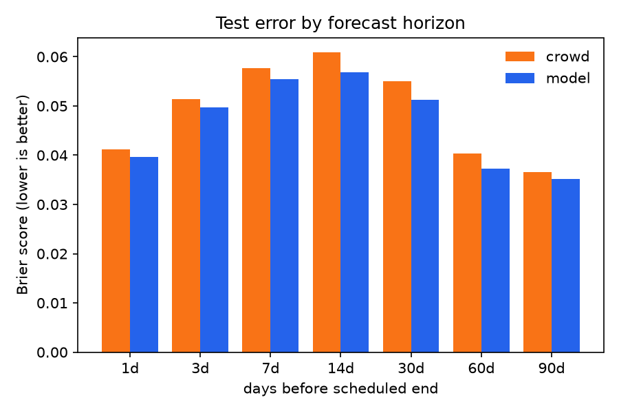
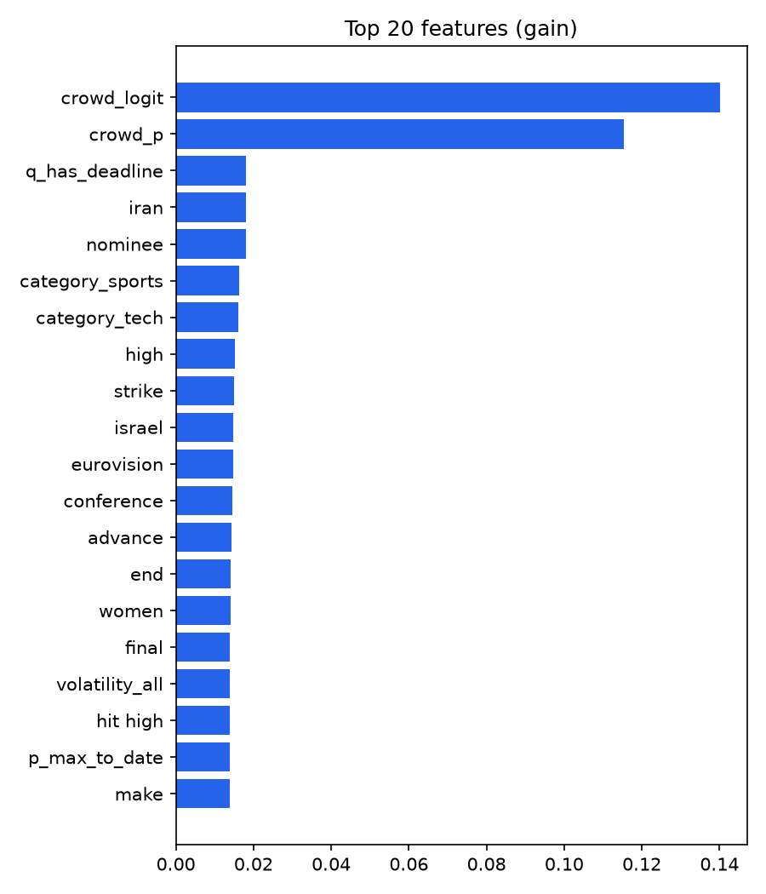
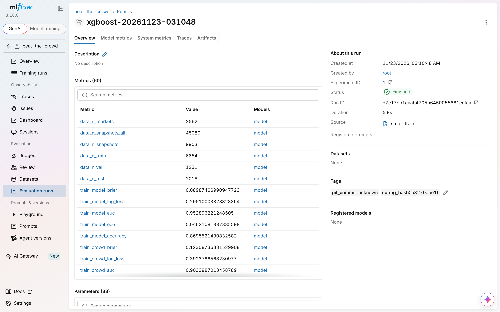

# Beat the Crowd

**Can a model trained on thousands of resolved Polymarket markets tell when today's crowd is wrong?**

Prediction markets had a huge 2026. Around the midterms, Polymarket odds were quoted on cable news next to the polls, and people are now betting real money on everything from Fed decisions to ceasefires. The pitch for these markets is that the price *is* the best available probability: if a contract trades at 30¢, the crowd thinks there's a 30% chance it happens.

We wanted to test that pitch. We pulled every resolved Yes/No market we could find, froze each one at several points before it closed, and trained a model to predict the outcome using only what was known at that moment, *including the crowd's own price*. If the crowd is efficient, the model should learn to just copy the price. If the crowd has systematic blind spots, the model should find them.

Paste any live Polymarket link into the app and it shows you the crowd's probability next to the model's.

| | |
|---|---|
| **Live app** | _coming soon (front-end in progress)_ |
| **API** | _coming soon (Cloud Run deployment in progress)_ |
| **Data** | `gs://beat-the-crowd/v1/` (public, see [Data](#data)) |

---

## What we found

**Short version: the crowd is hard to beat, but it isn't perfectly calibrated, and a model that knows how it's off does a bit better.** The improvement is real but small, it varies a lot from month to month, and it doesn't reliably turn into money.

| | Validation (mid-Aug → Oct 2026) | Test (Oct → mid-Nov 2026) |
|---|---|---|
| **Crowd** (market price) Brier | 0.1347 | 0.0495 |
| **XGBoost** Brier | 0.1306 | 0.0469 |
| ↳ skill vs. crowd (95% CI) | **+3.1%** (−3.0% to +9.6%) | **+5.2%** (−3.8% to +16.4%) |
| ↳ paper-trading ROI | +25% | −2.7% |
| **Logistic regression** Brier | 0.1323 | 0.0425 |
| ↳ skill vs. crowd (95% CI) | +1.8% (−5.5% to +10.7%) | +14.1% (+3.7% to +24.2%) |
| ↳ paper-trading ROI | +18% | +32% |

Confidence intervals come from a bootstrap that resamples whole *events*, since markets inside one event aren't independent. The test period covers the run-up to the November 3 midterms.

**1. The crowd is systematically under-confident.** Across all 45,080 snapshots, contracts trading around 58¢ resolved YES 65% of the time, and ones at 85¢ about 91%. Long shots go the other way: 14¢ contracts hit only 11%. This is the classic *favorite-longshot bias* from horse racing, showing up on Polymarket. A logistic regression on nothing but the crowd's price, just recalibrating it, already beats the raw price on the test set.


**2. The model beats the crowd at every horizon on the test set, but only modestly.** XGBoost has lower error from 1 day out to 90 days out. The gap is widest 2–4 weeks before the deadline, which is also where the crowd makes its biggest errors.

<p float="left">
  
  
</p>

**3. We picked the model on validation, not on test, and it mattered.** Logistic regression looks like the star on the test set (+14%), but it was the *worse* model on validation. Late 2026 happened to reward pushing lopsided prices further toward 0 or 1, which suits a simpler model. If we'd chosen by test score we'd be reporting a number that's mostly luck of the period. XGBoost won on validation, so it's what the API serves.

**4. Better probabilities ≠ profit.** Betting $1 whenever the model and crowd disagreed by 5+ points returned +25% on validation and −2.7% on test, before fees. A few large events with dozens of linked markets swing these numbers hard. Anyone hoping this is a money printer: it isn't.

**5. Two mistakes we caught along the way.** Our first run reported an AUC of 0.999 for *both* the model and the crowd, because 80% of snapshots were long shots priced at 0.1¢ that never happen. That's why the contested-markets filter exists. Later, the feature importance chart showed XGBoost leaning on tokens like "february 28" and "june 30", which memorizes which deadlines fell in the training window. We dropped numbers and month names from the text features, and validation skill went *up*. The model now leans on the crowd's price first, then on what kind of question it is (deadline phrasing, topic words like "iran" or "nominee", category).



## How it works

```
Polymarket APIs ──► ingest ──► clean ──► GCS bucket ──► features ──► split ──► train + evaluate ──► model.joblib
 (Gamma + CLOB)                           (public)       (snapshots)   (by event,    (MLflow)              │
                                                                         by time)                           ▼
                                                                      Front-end ──► FastAPI on Cloud Run ──┘
                                                                                     /predict/market
```

### Data

Everything comes from Polymarket's free, key-less public APIs:

- **Gamma API** (`gamma-api.polymarket.com`) for event and market metadata, tags, and how each market resolved
- **CLOB API** (`clob.polymarket.com`) for the daily price history of the YES token

`src/data/ingest.py` walks closed events newest-first and keeps markets that are:

- plain **Yes/No** questions that resolved cleanly to 1 or 0
- above **$25k in volume** (below that, one trader can move the price a lot)
- open for at least **7 days**

It also skips three tags at the source: individual sports games, recurring markets, and 5-minute crypto "Up or Down" markets. Since 2025 these make up most of Polymarket's volume, but they're a different animal (they last minutes or hours) and not what this project is about.

We keep the **12,000 most recent markets** that pass these filters, which works out to markets ending between July 2025 and mid-November 2026, across 3,077 events. After cleaning, that's **11,937 markets and 910,634 daily prices**. Politics, sports futures, elections and finance make up most of it, and about 24% of markets resolved YES.

The cleaned tables live in a public Google Cloud Storage bucket:

| File | What's in it |
|---|---|
| `v1/markets.parquet` | one row per market: question, event, tags, start/end dates, volume, outcome |
| `v1/prices.parquet` | one row per market per day: YES price |
| `v1/model/model.joblib` | the trained pipeline the API serves |

Because the bucket is public, `python -m src.data.storage download` (and the training script) can fetch the data without a Google Cloud account.

### Turning markets into training examples

The trick that makes this work is the **snapshot**. For each market we pretend it's 1, 3, 7, 14, 30, 60, or 90 days before the scheduled end date and compute features using only prices up to that moment. A snapshot only counts if the market was still open, so a market that resolved early can't leak its answer into a "30 days before" example. The live API computes features with the exact same function (`snapshot_features`), using "now" as the snapshot time.

Features (all in `src/features/build.py`):

- **The crowd:** current price and its log-odds
- **Momentum and volatility:** price change over 1/7/30 days, 7-day range, all-time high/low, day-to-day volatility
- **Time:** days until the scheduled end, market age, fraction of its life elapsed
- **Structure:** how many markets share the event (one candidate out of 20 vs. a standalone question), whether it's part of a mutually exclusive set
- **The question itself:** TF-IDF on the words (numbers and month names stripped, see below), plus flags for deadline language ("by", "before"), price thresholds ("above $X"), and head-to-heads
- **Category:** Polymarket's tags collapsed into ten buckets (politics, crypto, sports, geopolitics, ...)

**One filter matters a lot.** About 80% of snapshots are long shots priced under 3¢ or near-certainties above 97¢. Both the crowd and any model get those right, so including them makes every metric look amazing and hides what's interesting. We train and evaluate only on **contested snapshots, where the crowd's price is between 3% and 97%**. The API still scores markets outside that range, but attaches a warning.

### Splitting without fooling ourselves

A random row split would leak in two ways. Several snapshots come from the same market, and markets inside one event are tied together (if "Will X win?" resolves YES, "Will Y win?" resolves NO). So we split by **event**, and we order events by end date: the oldest 70% train, the next 15% validate (used for early stopping), and the most recent 15% test. The test set is the future, which is the question that actually matters.

### Model

A scikit-learn `Pipeline`: a `ColumnTransformer` (scaled numerics, one-hot category, TF-IDF question text) feeding an **XGBoost** classifier with early stopping on the validation set. Logistic regression is available as a baseline (`--model-type logistic_regression`). All hyperparameters live in `config.yaml`.

We score everything twice, once for the model and once for the crowd (the raw market price):

- **Brier score**: mean squared error of the probability, our primary metric (lower is better)
- **Brier skill vs. crowd**: `1 - model_brier / crowd_brier`. Above 0 means the model beat the market.
- log loss, ROC-AUC, expected calibration error, accuracy
- **Paper-trading ROI**: bet $1 whenever the model and the crowd disagree by more than 5 points. This ignores fees and slippage, so it's an optimistic upper bound, not a strategy.

### Experiment tracking

Every training run is logged to **MLflow**: all config values as params, the git commit and a hash of the config as tags, train/val/test metrics for model and crowd, plots (calibration, long-shot bias, error by horizon, feature importance), and the fitted model.



---

## Running it yourself

### Setup

Requires Python 3.11+.

```bash
git clone https://github.com/<you>/beat-the-crowd.git
cd beat-the-crowd
python -m venv .venv && source .venv/bin/activate
pip install -r requirements.txt
```

### Train the model

```bash
python -m src.models.train                                  # XGBoost, settings from config.yaml
python -m src.models.train --model-type logistic_regression # baseline
mlflow ui --backend-store-uri sqlite:///mlflow.db           # browse runs at http://localhost:5000
```

Training downloads the cleaned data from the public bucket on first run, then writes `models/model.joblib`, `models/model_card.json` and the plots in `reports/`. To rebuild the dataset from scratch instead (takes about 20 minutes):

```bash
python -m src.data.ingest
python -m src.data.clean
python -m src.data.storage upload        # needs `gcloud auth application-default login` + write access
```

### Run the API locally

```bash
uvicorn src.serving.app:app --port 8080
```

Interactive docs are at http://localhost:8080/docs. Score a live market:

```bash
curl -X POST localhost:8080/predict/market \
  -H "Content-Type: application/json" \
  -d '{"url": "https://polymarket.com/event/what-price-will-bitcoin-hit-before-2027"}'
```

or send raw inputs to `/predict`:

```bash
curl -X POST localhost:8080/predict \
  -H "Content-Type: application/json" \
  -d '{
        "question": "Will the Fed cut rates in December?",
        "price_history": [{"t": 1762000000, "p": 0.42}, {"t": 1762086400, "p": 0.47}, {"t": 1762172800, "p": 0.51}],
        "start_date": "2025-10-01T00:00:00Z",
        "end_date": "2025-12-10T00:00:00Z",
        "tags": ["Economy", "Fed"],
        "as_of": "2025-11-03T12:00:00Z"
      }'
```

| Endpoint | What it does |
|---|---|
| `POST /predict` | score one market from raw JSON (question, price history, dates, tags) |
| `POST /predict/market` | score every open Yes/No market behind a polymarket.com link |
| `GET /markets/trending` | busy events right now, to give the front-end something to show |
| `GET /model` | the model card: training date, git commit, test metrics |
| `GET /health` | liveness check |

### Docker

One image does everything. The default command serves the API, and any other pipeline command can be passed instead:

```bash
docker build -t beat-the-crowd .
docker run -p 8080:8080 beat-the-crowd                 # serve
docker run beat-the-crowd train                         # full training run inside the container
docker run --entrypoint pytest beat-the-crowd -q        # tests
```

If `models/model.joblib` exists when you build, it's baked into the image. Otherwise the API downloads it from the bucket on startup.

### Tests

```bash
pytest -q
```

The tests run on synthetic data, so they need no network access. The two we care about most check that features **never see prices after the snapshot time**, and that **no event appears in more than one split**. CI runs the tests and a Docker build on every pull request.

### Deploy to the cloud

_In progress: Cloud Run deployment steps._

---

## Project structure

```
├── config.yaml              every tunable setting: data filters, features, split, model, tracking
├── Dockerfile               one image for ingest / train / serve
├── requirements.txt
├── src/
│   ├── cli.py               entry point used by Docker
│   ├── config.py
│   ├── data/
│   │   ├── polymarket.py    API client (shared by training and serving)
│   │   ├── ingest.py        pull resolved markets + price history
│   │   ├── clean.py         raw JSONL -> Parquet
│   │   └── storage.py       GCS upload / public download
│   ├── features/build.py    leakage-safe snapshot features
│   ├── models/
│   │   ├── split.py         event-grouped temporal split
│   │   ├── model.py         preprocessing + XGBoost / logistic regression
│   │   ├── evaluate.py      metrics and plots vs. the crowd
│   │   └── train.py         MLflow-tracked training run
│   └── serving/
│       ├── predictor.py     loads the model, scores raw inputs or live links
│       └── app.py           FastAPI
├── tests/
└── .github/workflows/ci.yml
```

## Limitations and ethics

_In progress._

## Team

- **Hadley McCormack**: data ingestion and cloud storage, feature engineering, training pipeline and MLflow tracking, API, Docker, tests
- **Konur Nordberg**: cloud deployment, front-end, documentation
